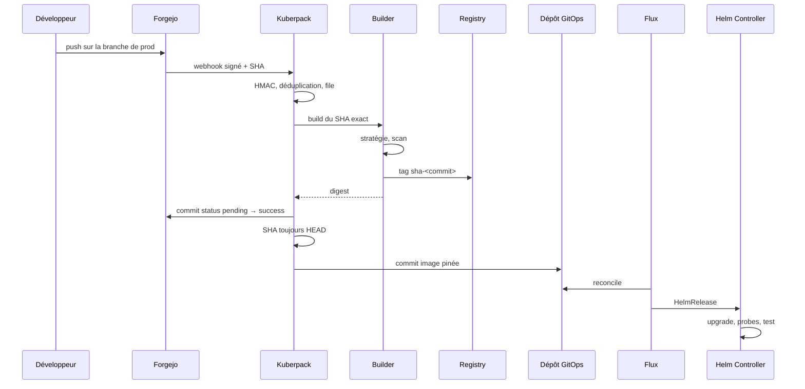

# Flux

## Déclaration

```http
POST /api/v1/projects
```

Le corps porte le manifeste `kuberpack.yaml` ([manifest](manifest.md), [API](api.md)).

Kuberpack compile le manifeste : il écrit le contrat GitOps du service (`values.yaml` avec `envFrom` vers `app-<service>`, HelmRelease, kustomization) **sans l’activer dans Flux**, inscrit l’app, crée le secret HMAC (hors SQLite), pose le webhook Forgejo (`push`, `pull_request`) puis lance le premier build. Le premier digest piné ajoute le service au kustomization du projet. Ensuite, un push ne change plus que le champ `image` ; un changement du manifeste régénère le `values.yaml` en conservant l’image épinglée. Rien n’est écrit dans le dépôt applicatif. L’administrateur crée `app-<service>` (Infisical ou kubectl) avant ou après ; le `secretRef` est optional, donc une app sans secret démarre quand même.

Les projets sont un second arbre GitOps : ils exigent leur propre `Kustomization` Flux (`path: ./kubernetes/vps/projects`).

## Production



- échec de build ou de scan → Git inchangé ;
- seul le HEAD courant de la branche peut être promu ;
- un job lent ne remplace pas un SHA plus récent ;
- un seul bot committe les digests applicatifs.

## Previews

Un drapeau : `autodeploy_pr: true`.

- release `<app>-pr-<numero>` ;
- hôte `pr-<numero>.<app>.<preview-domain>` ;
- quota, PSA `restricted`, ressources inférieures à la prod ;
- aucun secret de production ;
- forks ignorés sans approbation ;
- TTL + GC si le webhook `closed` est perdu.

Fermer la PR supprime le manifeste ; Flux prune.

## Webhook HTTP

HMAC faux → `401`. JSON invalide → `400`. Événement hors périmètre → `204`. Accepté → `202` immédiat, travail en file. Reprise au redémarrage depuis SQLite.
